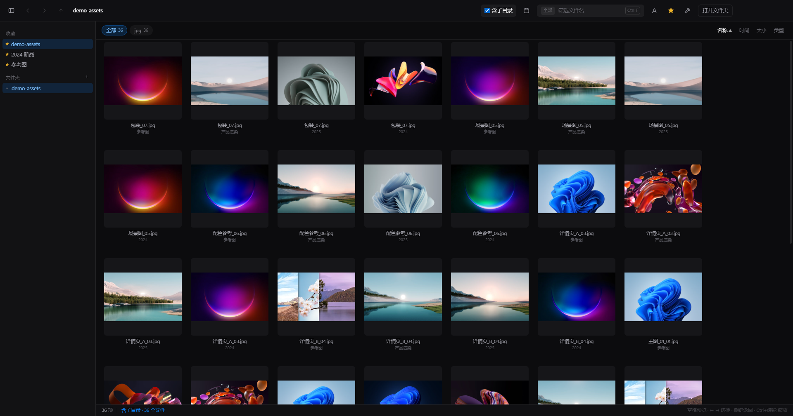
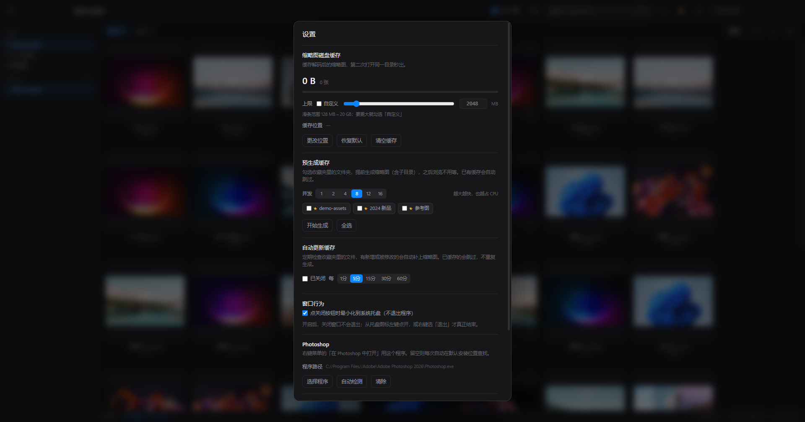

# 素材浏览器 · Asset Browser

一个 Windows 上的**本地素材浏览器**。给设计师用的：不用等缩略图、不用装臃肿的 DAM，打开就扫，几万个文件也不卡。

Tauri 2 + Rust 后端 + React 前端。**免安装版 12 MB，内存占用约 25 MB**（对比 Electron 同功能约 190 MB / 150 MB）。

<p align="center">
  
</p>

## 它解决什么问题

资源管理器看 PSD、AI、RAW 只有图标；专业素材管理软件动辄几百兆、要导入素材库、要等索引。

这个工具的做法很简单：**直接读文件夹，按需解码缩略图，解完写进本地缓存**。不导入、不改你的文件、不联网。

## 功能

**浏览**
- 文件夹树 + 收藏夹（多根目录并行，可拖文件夹或**快捷方式**进来）
- 虚拟滚动，1.2 万个文件稳定 60fps
- 双击用系统程序打开；空格预览；方向键导航；鼠标侧键前进/后退
- 面包屑每一级可点，后退/前进保留完整层级

**缩略图**
- JPEG 走 IDCT 缩放解码（只解到目标尺寸，不解全图）
- **PSD 双通道**：优先读内嵌缩略图（3ms）；没有就解合成图（RLE / raw，支持 RGB / CMYK / 灰度，30–70ms）
- 支持 jpg / jpeg / png / webp / bmp / gif / tif / tiff / psd / psb
- 内存 LRU + SQLite 磁盘缓存（WAL），缓存命中约 3ms

**筛选与排序**
- 后缀筛选（带数量统计，跟随其它筛选条件联动）
- 搜索：全部 / 只看文件名 / 只看文件夹名
- 按修改时间区间筛选
- 自定义隐藏不想看到的后缀（如 xlsx、db）
- 排序：名称 / 修改时间 / 大小 / 类型，升降序

**批量与设置**
- 预生成缓存：勾选收藏夹，1–16 并发，可暂停/继续/停止，实时显示速率与剩余时间（实测 1.2 万个文件约 97 秒）
- 自动更新缓存：定时检查收藏夹，新增或改动过的自动补图
- 字号 70%–160% 可调（面板本身不跟着缩放，避免调字号时滑块跳动）
- 缓存目录、缓存上限都可改（滑条最大 20 GB，勾「自定义」可输入到 1 TB）
- 关闭窗口最小化到系统托盘
- 右键「在 Photoshop 中打开」，找不到可手动指定 Photoshop.exe

<p align="center">
  
</p>

## 下载

到 [Releases](https://github.com/jaymik1947/asset-browser/releases) 下载：

| 文件 | 说明 |
| --- | --- |
| `AssetBrowser-0.1.0-portable.exe` | 单文件绿色版，双击即用（12 MB） |

需要 **WebView2 运行时**（Win11 自带；Win10 一般也自带，缺失时系统会提示安装）。

想要安装包（装进系统 + 开始菜单快捷方式）：按下面「从源码构建」跑一遍，产物在 `src-tauri/target/release/bundle/nsis/`。

> 介绍页：https://jaymik1947.github.io/asset-browser/

## 从源码构建

环境要求：Windows 10/11、Node 20+、Rust stable（含 MSVC 工具链）、WebView2。

```bat
npm install
npm run tauri build
```

产物在 `src-tauri\target\release\`：

- `asset-browser.exe` —— 免安装版
- `bundle\nsis\*.exe` —— 安装包

开发模式：

```bat
npm run tauri dev
```

> 改完前端必须重新跑 `tauri build`（或 `tauri dev`）才生效——`dist/` 是在编译时**嵌入 exe** 的，不是运行时读取。这条踩过坑，见 [AGENTS.md](AGENTS.md)。

## 技术结构

```
src/                     React 前端
  components/Grid.tsx    虚拟滚动 + 缩略图队列（优先级/剪枝在这里）
  components/Settings.tsx 设置面板
  lib/thumb.ts           前端缩略图缓存与并发调度
src-tauri/src/           Rust 后端
  commands.rs            IPC 命令、路径打开、Photoshop 启动
  thumb.rs               图片/PSD 解码（含合成图 RLE 解压）
  cache.rs               SQLite 缓存 + 内存层 + LRU 淘汰
  prewarm.rs             批量预生成 / 定时刷新
```

关键数据流：前端按可见范围给每个格子发 `get_thumb(path, 400)` → Rust 查缓存（内存 → SQLite）→ 未命中则解码 → 写回缓存 → 返回 JPEG dataURL。前端只保留最近 2500 条。

## 已知限制

- **仅 Windows**（用了 Win32 API 做托盘、快捷方式解析、系统代码页转换）
- `.ai` / `.indd` / `.c4d` / `.max` 这类格式没有解码器，显示为灰色徽标
- 没有内嵌缩略图、且合成图为空白的 PSD，只能显示灰徽标（是文件本身的问题）
- 不做文字识别（OCR），搜索只匹配文件名和文件夹名

## 参与开发

欢迎 PR。改代码前先看 [AGENTS.md](AGENTS.md)：里面有模块职责、常见坑（比如 `PIPELINE_VER` 改了会让所有缓存失效）、以及测试方式。

## License

[MIT](LICENSE)
